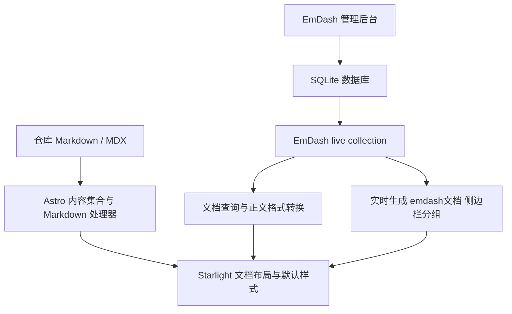

# EmDash CMS 接入说明

本文说明本项目为接入 EmDash 新增、修改了哪些文件，各文件的作用，以及安装、发布、渲染和构建流程。内容以当前仓库实现为准。

## 1. 接入后的整体关系

本项目同时支持两类文档：

| 内容来源 | 编辑方式 | 存储位置 | 读取方式 |
| --- | --- | --- | --- |
| 原有 Markdown/MDX 文档 | 修改仓库文件 | `src/content/docs/` | Astro 内容集合 |
| EmDash 文档 | 在管理后台编辑、保存、发布 | 本地 SQLite `data.db` | EmDash live collection，按请求查询 |

EmDash 提供管理后台、内容模型、草稿/发布、用户和媒体管理。Astro 负责路由、渲染和构建；Starlight 提供文档站布局、导航组件、正文排版和主题样式。

EmDash 发布内容不会自动生成 `.md` 文件，也不会自动创建 Astro 页面。项目中的接入代码负责把数据库内容连接到公开页面和侧边栏。



CSS、浏览器脚本、图标等仍是 Astro 提供的静态资源。数据库内容和主题资源是两个层面：发布文章改变数据库；修改主题或前端代码后，生产环境才需要重新构建和部署代码。

## 2. 配置层级

```text
astro.config.mjs
  ├─ 导出 createDocsConfig() 公共文档配置工厂
  └─ 默认导出：静态文档模式

astro.config.cms.mjs
  ├─ createDocsConfig(emdashStarlightOptions)
  └─ mergeConfig(..., createEmDashConfig())
       └─ config/EmDash.mjs
            ├─ Node 适配器、React、EmDash
            ├─ SQLite 与本地媒体
            ├─ CMS 公开路由、缓存中间件
            └─ Starlight 服务端渲染与侧边栏中间件

config/sidebar.mjs
  ├─ 原仓库文档导航
  └─ emdashSection：CMS 分组名称、URL 前缀；分组追加在静态导航之后
```

两套入口复用公共配置，避免为了本地 CMS 试验直接改变原静态部署流程。CMS 入口使用 `mergeConfig()` 合并配置，保留公共集成和 Vite 设置。

### `config/EmDash.mjs` 中的关键设置

| 设置 | 当前值及作用 |
| --- | --- |
| `contentTypes` | `['posts', 'pages']`，决定纳入公开文档和导航的内容类型 |
| `output` | `server`，允许后台、API、文档页面按请求运行 |
| `adapter` | Node standalone；当前仅用于本地 Node 环境 |
| `site` / `base` | `http://localhost:4322` / `/`，当前本地 CMS 地址 |
| `server` | 使用 localhost 的 4322 端口 |
| `outDir` | `dist-cms`，与静态构建产物隔离 |
| `trailingSlash` | `ignore`，兼容 EmDash 后台和 API 的无尾斜杠请求 |
| `react()` | 为 EmDash React 管理后台注册渲染支持 |
| `database` | SQLite，`file:./data.db` |
| `storage` | `./uploads`，通过 `/_emdash/api/media/file` 提供媒体访问 |
| `optimizeDeps.include` | 预打包 `react-dom/client`，解决后台 React 挂载失败问题 |

`emdashStarlightOptions` 另外设置：

- `prerender: false`：CMS 模式下，原仓库文档也按请求渲染，侧边栏才能反映新发布内容。只有 `output: 'server'` 不足以覆盖 Starlight 默认的预渲染行为。
- `pagefind: false`：CMS 模式暂不提供 Pagefind 搜索，避免使用无法跟随数据库发布更新的构建时索引。
- `routeMiddleware`：指定 `src/cms/sidebar.ts`，修改每次请求的 Starlight 导航数据。

`EMDASH_LOCAL_CMS` 和 `EMDASH_CONTENT_TYPES` 是通过 Vite `define` 注入的构建标记，不是数据库中的站点设置，也不需要手动填写到 `.env`。

## 3. 新增文件及作用

| 新增文件 | 作用 |
| --- | --- |
| [astro.config.cms.mjs](./astro.config.cms.mjs) | CMS 运行入口，组合公共文档配置与 EmDash 模块 |
| [config/EmDash.mjs](./config/EmDash.mjs) | 集中声明 EmDash 集成、本地数据库和媒体、SSR 配置、路由和兼容设置 |
| [src/live.config.ts](./src/live.config.ts) | 注册 `_emdash` live collection，让查询函数能够读取数据库内容；静态模式下不加载 EmDash 运行时 |
| [src/cms/documents.ts](./src/cms/documents.ts) | 查询所有已发布 Posts/Pages，生成文档链接，并在同一请求内复用查询结果 |
| [src/cms/sidebar.ts](./src/cms/sidebar.ts) | 将已发布文档加入 Starlight 的顶层“emdash文档”分组，设置当前项高亮及 CMS 文档前后页链接 |
| [src/cms/middleware.ts](./src/cms/middleware.ts) | 为公开 HTML 设置 `Cache-Control: no-store`，防止实时导航跨请求使用旧缓存；保留 EmDash 自身 API 和媒体缓存策略 |
| [src/cms/pages/index.astro](./src/cms/pages/index.astro) | `/emdash/` 文档总览 |
| [src/cms/pages/document.astro](./src/cms/pages/document.astro) | 按类型和 slug 查询文档，选择正文渲染方式；不存在或不可见的文档返回 404 |
| [src/cms/pages/legacy.astro](./src/cms/pages/legacy.astro) | 将早期 `/posts` 地址 301 跳转到新的文档地址，保留查询参数 |
| [src/layouts/DocumentLayout.astro](./src/layouts/DocumentLayout.astro) | 直接引用官方 `StarlightPage`，复用默认文档布局及样式，无自定义 CSS |
| [src/components/content/markdown.mjs](./src/components/content/markdown.mjs) | 识别整篇粘贴为普通段落的 Markdown，恢复行内格式、解析结构、生成目录，并清理输出 HTML |
| [src/components/content/MarkdownContent.astro](./src/components/content/MarkdownContent.astro) | 把解析结果交给官方 `Code`、`Aside`、`AnchorHeading` 等组件；普通 HTML 使用 Starlight 正文排版 |
| [src/components/content/CodeBlock.astro](./src/components/content/CodeBlock.astro) | 将 EmDash 原生富文本代码块的数据绑定到 Starlight 官方 `Code` 组件 |
| [scripts/cms-markdown.test.mjs](./scripts/cms-markdown.test.mjs) | Markdown 兼容测试，覆盖结构、行内格式、锚点、安全清理、表格对齐和任务状态 |
| [docs/emdash-local-trial.md](./docs/emdash-local-trial.md) | 本地验收说明、现有接入边界与后续 Cloudflare 方案 |

`src/cms` 这个目录名是本项目的组织方式，不是 EmDash 或 Astro 的强制要求。页面位于该目录仍能提供 URL，是因为 `config/EmDash.mjs` 使用 `injectRoute()` 显式注册了路由。

## 4. 修改过的原有文件

| 文件 | 修改及原因 |
| --- | --- |
| [astro.config.mjs](./astro.config.mjs) | 提取 `createDocsConfig(starlightOptions)`，让静态入口和 CMS 入口共用站点配置；默认导出仍用于静态文档 |
| [config/sidebar.mjs](./config/sidebar.mjs) | 增加 `emdashSection`，声明分组名称 `emdash文档` 和前缀 `/emdash/`；运行时追加在所有静态文档导航之后 |
| [package.json](./package.json) | 新增 CMS 管理命令与接入依赖；将 Sätteri 放入运行时依赖 |
| [pnpm-lock.yaml](./pnpm-lock.yaml) | 固定依赖解析结果，供其他机器和 CI 重现安装 |
| [.gitignore](./.gitignore) | 排除本地数据库、上传媒体、密钥、CMS 构建产物和自动生成文件 |
| [README.md](./README.md) | 更新 Sätteri 依赖用途说明；其余既有说明应以当前仓库为准 |

原 `src/content.config.ts` 和文件型文档集合继续工作。原 `wrangler.jsonc`、静态资源准备脚本、GitHub Pages 发布流程没有在本次 CMS 接入中转换为服务端部署。

## 5. 依赖安装做了什么

接入时安装了：

```powershell
pnpm add emdash @astrojs/node @astrojs/react react react-dom
pnpm add --save-prod satteri@0.10.5 sanitize-html
```

| 依赖 | 用途 |
| --- | --- |
| `emdash` | CMS 集成、后台、数据库与媒体接入、内容查询和 Portable Text 渲染 |
| `@astrojs/node` | 本地 Node 服务端适配器 |
| `@astrojs/react`、`react`、`react-dom` | EmDash 管理后台依赖的 React 支持；公开文档不因此全部变成 React 应用 |
| `satteri` | 解析粘贴的 Markdown；原项目的 FileTree 也使用其原生解析能力 |
| `sanitize-html` | 清理 Markdown 转换产生的 HTML，保留允许的结构、移除脚本等不适合直接输出的内容 |

以上命令用于说明接入操作。日常获取仓库后执行 `pnpm install` 即可，通常不需要再次执行 `pnpm add`。

## 6. 本地生成的数据和产物

| 路径 | 内容 | 管理方式 |
| --- | --- | --- |
| `.env` | 本地 `EMDASH_ENCRYPTION_KEY` | 已忽略；已有密钥不要重复生成，需安全备份 |
| `data.db` | 站点设置、账号、内容模型、草稿及发布内容等 SQLite 数据 | 已忽略；发布内容的主要持久化数据 |
| `data.db-*` | SQLite 日志及共享内存等旁文件 | 已忽略；不要在运行中随意删除 |
| `uploads/` | 本地上传媒体 | 已忽略；有重要媒体时需备份 |
| `emdash-env.d.ts` | 根据当前 CMS 内容模型生成的 TypeScript 声明 | 已忽略；自动生成，不手动编辑 |
| `.emdash/migrations.json` | EmDash 构建生成的迁移清单 | 已忽略；不应与正文文档混淆 |
| `.astro/` | Astro 缓存、类型及后台服务器锁文件和日志 | 已忽略；属于开发生成物 |
| `dist-cms/` | Node CMS 服务端构建产物 | 已忽略；不同于原静态部署目录 |

数据库、媒体和密钥不会因为提交代码而自动同步到其他机器，也不会因为 `pnpm install` 自动恢复。备份运行中的 SQLite 应使用一致性备份方式；需要直接复制文件时，先停止服务再备份。

## 7. 本地操作流程

### 安装与首次初始化

在项目根目录使用项目要求的 Node.js 与 pnpm：

```powershell
pnpm install
```

仅在全新环境、尚无本地密钥时执行一次：

```powershell
pnpm exec emdash secrets generate --write .env
```

当前试验环境已经生成密钥。不要为排查页面问题而重新生成已有密钥或删除数据库。

### 启动和管理服务

```powershell
pnpm run dev:cms
pnpm run cms:status
pnpm run cms:logs
pnpm run cms:stop
```

`dev:cms` 实际执行 `astro dev --config astro.config.cms.mjs --background`，在后台启动 CMS 开发服务器。其他命令分别检查状态、读取日志和停止服务。

Astro 按项目根目录管理服务器锁。原静态开发服务和 CMS 开发服务应轮流运行；切换时先确认当前服务，再停止并启动另一模式。以终端实际输出的地址为准。

| 本地地址 | 用途 |
| --- | --- |
| <http://localhost:4322/> | 文档首页，包含动态 CMS 导航 |
| <http://localhost:4322/_emdash/admin/> | EmDash 管理后台 |
| <http://localhost:4322/emdash/> | CMS 文档总览 |
| <http://localhost:4322/emdash/posts/test2/> | 现有 Markdown 粘贴测试文档 |

首次访问后台时，按向导填写站点信息、创建管理员、注册 Passkey 并登录。账号和 Passkey 由使用者在本机设置。

### 发布和更新文档

1. 在 Posts 或 Pages 新建内容，设置标题、slug 和正文。
2. 保存草稿，再点击 Publish。
3. 刷新文档首页或其他文档页，内容自动出现在“emdash文档”分组下。
4. 修改正文并重新发布后，下一次请求读取新发布版本。
5. 取消发布、归档或删除后，公开导航不再列出该内容；不可见详情返回 404。

仅保存草稿时，普通公开访问继续读取已有发布版本；有授权的预览访问属于 EmDash 的预览流程。

## 8. 发布后如何进入侧边栏

`src/cms/documents.ts` 对 `contentTypes` 中的集合查询已发布内容，每页取 100 条并继续遍历后续分页。结果按集合配置顺序排列，同集合按创建时间升序排列。

`src/cms/sidebar.ts` 将结果插入当前请求的 `starlightRoute.sidebar`，形成：

```text
文档首页
实验室服务器
astro静态文档使用参考

emdash文档
  文档总览
  已发布文档…
```

“emdash文档”是前台导航分组，不是数据库文件夹，不需要在后台手动把每篇内容移到目录中。新增其他内容类型时，需要在 `config/EmDash.mjs` 的 `contentTypes` 中明确纳入。

内容查询只在同一个请求内复用，避免总览与导航重复查询；没有跨请求永久缓存文档列表。公开 HTML 使用 `no-store`，确保刷新后可以读取新导航。

### 公开路由

| 路由 | 行为 |
| --- | --- |
| `/emdash/` | 文档总览 |
| `/emdash/posts/[...slug]/` | Posts 文档 |
| `/emdash/pages/[...slug]/` | Pages 文档，避免与 Posts 同名 slug 冲突 |
| `/posts`、`/posts/` | 301 跳转 `/emdash/` |
| `/posts/[...slug]` | 301 跳转对应的新 Posts 地址，并保留查询参数 |

链接使用 EmDash 返回的 `entry.id` 生成，保留可能存在的语言前缀。路由变化不会搬移数据库中的内容。

## 9. 正文如何使用 Starlight 样式

CMS 总览、详情使用 `DocumentLayout.astro`，它直接引用官方 `StarlightPage`。原仓库文档也由 Starlight 渲染，因此两者共用主题配置和正文排版。

当前没有为 CMS 编写独立主题 CSS，也没有复制 Starlight 的样式表。`src/cms` 保留接入逻辑，通用正文格式转换位于 `src/components/content`。

正文有两条处理路径：

| 正文形式 | 处理方式 |
| --- | --- |
| EmDash 原生富文本 | 使用 `PortableText`；原生代码块绑定官方 Starlight `Code` |
| 整篇 Markdown 被粘贴成普通段落 | 识别结构并重建 Markdown，用 Sätteri 解析，再复用官方 `Code`、`Aside`、`AnchorHeading`；普通 HTML 继承 Starlight 正文样式 |

额外格式转换的原因是：CSS 只能装饰已经生成的 HTML，不能把 `<p>## 标题</p>` 自动变成 `<h2>标题</h2>`。这部分保留了用户确认需要的 Markdown 显示效果，不是另一套主题。

Markdown 兼容识别是有边界的：已包含真正富文本标题、列表、图片或自定义块的内容不会被整体重解释；它不执行 MDX/JavaScript。粘贴时丢失的原始空行等排版也不能精确恢复。

其他 EmDash 专有块仍按其自身渲染能力处理，不代表自动获得了某个 Starlight 专属组件的功能。后续新增特殊块时，需要核对其语义和主题兼容性。

Starlight 的主题配色、字体等配置会同时影响两类文档。若换成完全不同的主题框架，需要适配文档布局及框架专有组件；Astro 不提供任意主题之间零修改切换的统一页面接口。

从仓库文档复制的相对链接、`src/assets` 图片路径不会自动迁移。应改成有效站内地址，或通过媒体库上传后引用。

## 10. 何时需要刷新、重启或构建

| 操作 | 需要做什么 |
| --- | --- |
| 后台发布、重新发布、取消发布 | 刷新公开页面即可，无需重新构建或重启 |
| 修改正文组件、布局等源码 | 开发模式由 Astro 监听更新；生产环境需要重新构建和部署代码 |
| 修改 EmDash 配置、内容类型纳入规则、路由配置 | 重启本地服务，使配置生效；生产环境重新构建和部署 |
| 更换机器 | 安装依赖，并另外恢复需要的数据库、媒体和密钥 |

CMS 发布不会触发 Astro 源码 HMR，已经打开的浏览器标签页不会因此自动刷新。当前采用请求时读取数据库，所以刷新页面即可看到已发布版本。

## 11. 构建、测试和部署边界

| 命令 | 用途与产物 |
| --- | --- |
| `pnpm run build` | 原静态文档构建，生成 `dist/`、Pagefind 索引及 `dist-cloudflare/` |
| `pnpm astro build --config astro.config.cms.mjs` | Node CMS 服务端构建，生成 `dist-cms/` |
| `node --test scripts/cms-markdown.test.mjs` | 运行 Markdown 兼容与安全清理测试 |

CMS 模式关闭了 Pagefind，因为数据库发布不会自动更新构建时搜索索引。实时全文搜索尚未接入。原静态构建仍保留 Pagefind。

现有 `wrangler.jsonc` 和 `scripts/prepare-cloudflare.mjs` 用于静态资源部署，不能直接部署 CMS 服务端产物。GitHub Pages 也无法运行 EmDash 后台和数据库查询页面。

目前完成的是本地 Node + SQLite + 本地媒体试验，尚未创建或部署 Cloudflare CMS 资源。后续需切换到 Cloudflare 适配器，并配置 D1、R2、会话、密钥和需要的后台任务，另行处理数据迁移；本地数据库和媒体不会自动同步。

## 12. 已处理的接入问题

| 现象 | 原因与处理 |
| --- | --- |
| 发布成功但公开地址 404 | 发布只写数据库；通过注入总览、详情路由并查询内容解决 |
| 后台部分路径 404 | 强制尾斜杠与后台/API 地址不兼容；CMS 配置使用 `trailingSlash: 'ignore'` |
| 后台停在 Loading EmDash | React 客户端入口未正确预打包；显式包含 `react-dom/client` |
| 静态构建无法解析 EmDash 虚拟模块 | 按 CMS 构建标记隔离 live collection 的运行时导入 |
| Markdown 标记直接显示为文字 | 富文本粘贴保留为普通段落；增加格式转换，并使用 Starlight 官方组件渲染 |
| 原文档侧边栏不跟随 CMS 发布更新 | CMS 模式关闭 Starlight 预渲染，并按请求生成侧边栏 |

之前的构建验证出现过 Google 字体源访问失败、大分块和空 i18n 等提示；当时静态及 CMS 构建均完成。文档维护时应区分网络警告与实际构建错误，不应通过删除数据库或重置密钥处理前端问题。

## 13. 参考资料

- [向现有 Astro 项目添加 EmDash](https://docs.emdashcms.com/existing-project/)
- [EmDash for Astro Developers](https://docs.emdashcms.com/coming-from/astro/)
- [EmDash 内容查询](https://docs.emdashcms.com/guides/querying-content/)
- [Astro EmDash 集成指南](https://docs.astro.build/zh-cn/guides/cms/emdash/)
- [Starlight 自定义页面](https://starlight.astro.build/guides/pages/#custom-pages)
- [Starlight 路由数据](https://starlight.astro.build/guides/route-data/)
- [Starlight SSR](https://starlight.astro.build/manual-setup/#use-starlight-with-ssr)
- [Cloudflare EmDash 框架指南](https://developers.cloudflare.com/workers/framework-guides/web-apps/emdash/)
