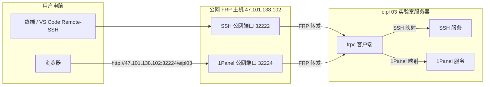

import { LinkButton } from '@astrojs/starlight/components';


五台机器按各自使用人群手动管理，本文记录现有配置与登录方式，不采用 Ansible /HCL 统一管理。

:::note[信息说明]
未提供的信息以“未提供”标注，具体配置以对应机器和负责人确认为准。
:::

## 机器与使用人群

| 机器 | 状态 | 负责人 | 内存 | 显卡 | 系统 | 主要的在用人群 | 磁盘 | LVM 状态 | 数据盘(机械盘)挂载目录 |
| --- | --- | --- | --- | --- | --- | --- | --- | --- | --- |
| eipl 01 | 可用 | 袁圣权 | 32 GB | RTX 3080 | Ubuntu 20 | 研一同学 | 1 TB 固态系统盘；4 TB 机械盘 | 机械盘已使用 LVM | 一般为 `/data` |
| eipl 02 | 可用 | 王佳贺 | 32 GB | RTX 4090D | Ubuntu 26 | 研二同学，少部分研三同学 | 512 GB 固态系统盘；2 TB + 4 TB 机械盘 | 4 TB 机械盘已使用 LVM；   2 TB 机械盘原始挂载； | `/mnt/dataset` 4T   `/mnt/data` 2T |
| eipl 03 | 可用 | 袁圣权 | 64 GB | RTX 2080 × 2 | Ubuntu 26 | 研一同学 | 512 GB 固态系统盘；1 TB 机械盘 | 机械盘已使用 LVM | 一般为 `/data` |
| eipl 04 | 可用 | 黄俊晟 | 32 GB | RTX 4090D | Ubuntu 24 | 研三同学 | 未提供 | 未提供 | 未提供 |
| eipl 05 | 可用 | 袁圣权 | 128 GB | RTX 3090 | Ubuntu 26 | 研一同学，少部分研二同学 | 1 TB + 1 TB 固态系统盘；4 TB 机械盘 | 机械盘已使用 LVM | 一般为 `/data` |

## 初始化服务设置

公网 FRP 主机 IP：`47.101.138.102`。下表 SSH 与 1Panel 端口均为公网访问端口。

| 机器 | FRP 可用端口范围 | SSH 端口 | 管理员账号 | 1Panel 端口 | 1Panel 地址 |
| --- | --- | --- | --- | --- | --- |
| eipl 01 | `42220/42230` | 42222 | `eipl` | 42224 | [打开面板](http://47.101.138.102:42224/eipl) |
| eipl 02 | `22220/22230` | 22222 | `eipl02` | 22224 | [打开面板](http://47.101.138.102:22224/eipl02) |
| eipl 03 | `32220/32230` | 32222 | `eipl03` | 32224 | [打开面板](http://47.101.138.102:32224/eipl03) |
| eipl 04 | 未提供 | 未提供 | 未提供 | 未提供 | 未提供 |
| eipl 05 | `52220/52230` | 52222 | `eipl05` | 52224 | [打开面板](http://47.101.138.102:52224/eipl05) |

### 网络与服务访问示意

以 03 号机为例：SSH 和 1Panel 使用同一公网 IP、不同公网端口，经 FRP 转发至机器上的对应服务。其他机器的公网端口见上表。



### Frpc 说明与注意事项

- 01、02、03、04、05 号机已安装 Frpc 服务，一般位于 `/etc/frpc` 或 `/opt/frpc`。
- 使用 `sudo systemctl status frpc.service` 查看服务状态及相关信息。

### 1Panel 说明与注意事项

- 默认安装目录：`/opt/1panel`。面板入口使用上表完整 URL，包含端口及路径。

### SSH 说明与注意事项

- 管理员默认关闭密码登录，仅支持密钥登录；使用上表管理员账号、SSH 端口和对应机器的管理员私钥。
- 普通用户账号由对应负责人创建，一般无 `sudo` 权限，使用预设密码登录。

### 默认安装的环境/工具

提供的命令安装 `nvitop`，供用户查看显卡状态, 或者`nvidia-smi`查看，以及安装一些二进制工具：

```bash
sudo apt install -y \
  screen tmux tree vim \
  bat fd-find ripgrep jq less \
  htop ncdu \
  git curl wget rsync net-tools \
  fzf unzip git \
  7zip just \
  cmake ninja-build

# herdr , pi , codex , claude ,,,,

sudo apt install pipx
sudo pipx ensurepath --global
sudo pipx install --global nvitop

# 个人使用 mise/uv 用户级配置环境/工具也可以。

# nvitop 查看显卡占用
# nvidia-smi 查看显卡占用
```

Conda 一般已由管理员全局安装，具体以所在机器为准。

---

## 普通用户使用说明

### 申请账号与登录

- 联系对应负责人创建账号并获取用户名、预设密码。普通用户一般无 `sudo` 权限。

在本地 SSH 配置文件 `~/.ssh/config` 中添加以下内容，将 `X`、`XXX` 和端口占位符替换为实际信息：

```text
Host EIPL0X-实验室X号机器-用户XXX，起一个别名即可
  HostName 47.101.138.102
  User XXX
  Port <对应机器的SSH端口>
```

SSH 端口见上方“初始化服务设置”表。VS Code Remote-SSH 可选择上述主机配置连接；需要安装系统软件时联系负责人。

### 个人数据一般放在机械盘


个人用户的 home 目录（～/）下通常有指向机械盘的软链接，由管理员维护，

机械盘单独挂载 和 系统盘隔离， 使用时直接往内部存放数据即可，避免把系统盘塞满。

| 机器 | home 目录下的软链接 | 软连接 指向的机械盘 目标目录 ，具体对应关系以实际配置为准 |
| --- | --- | --- |
| eipl 01 | `~/data` | `/data/personal/用户名` |
| eipl 02 | `~/public`、`~/personal` 等 |  `/mnt/data/public/用户名`、`/mnt/dataset/personal/用户名` |
| eipl 03 | `~/data` | `/data/users/用户名` |
| eipl 04 | 未提供 | 未提供 |
| eipl 05 | `~/data` | `/data/personal/用户名` |

已安装 `nvitop` 时，运行：

```bash
nvitop # 查看显存使用状态
nvidia-smi # 看显存使用状态
```

Python 虚拟环境：按个人需要选择 Conda 或 uv。

Conda: 一般已由管理员全局安装，具体以所在机器为准。

其他环境： mise/uv 用户级 管理环境即可。

## 各机器使用手册

<LinkButton href="../manuals/eipl01/" variant="secondary" icon="right-arrow">1 号机普通用户使用手册</LinkButton>

<LinkButton href="../manuals/eipl02/" variant="secondary" icon="right-arrow">2 号机普通用户使用手册</LinkButton>

<LinkButton href="../manuals/eipl03/" variant="secondary" icon="right-arrow">3 号机普通用户使用手册</LinkButton>

<LinkButton href="../manuals/eipl05/" variant="secondary" icon="right-arrow">5 号机普通用户使用手册</LinkButton>
